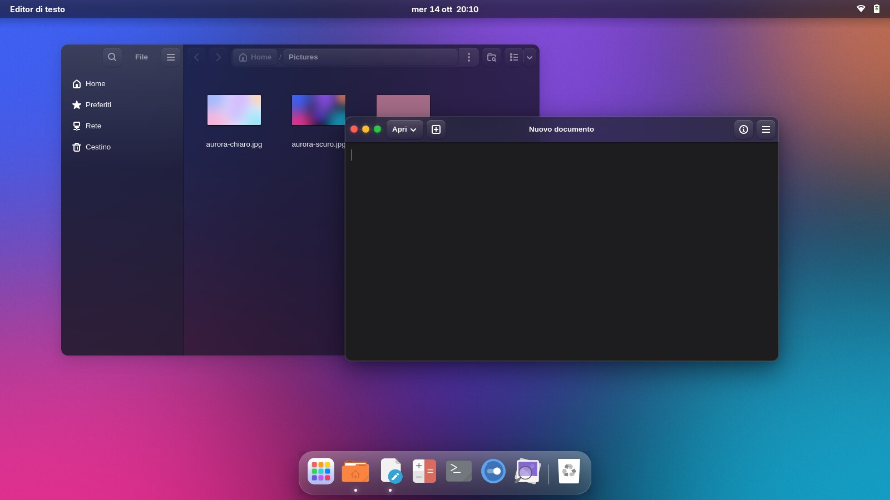
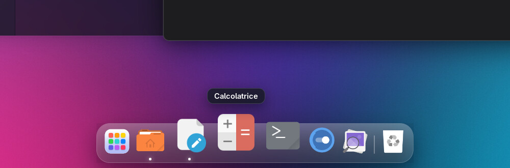
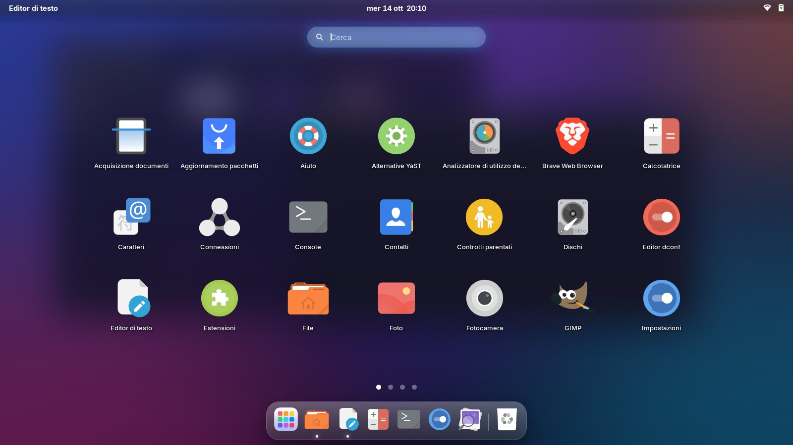

# Glassy

A frosted-glass **GNOME 50** desktop inspired by macOS: translucent windows with real blur, lit edges,
colored traffic-light buttons on the left, a **dock with magnification**, a **full-screen app launcher**
that replaces Activities, and smooth transitions. It follows light/dark mode and the accent color chosen in
*Settings → Appearance*.



| Dock with magnification | Launchpad |
|---|---|
|  |  |

> The images are real screenshots of a GNOME Shell 50 with Glassy installed (a test session without a real
> display, hence without the GNOME portal: some apps show the light theme for that reason).

> **Language:** the installer messages, the settings panel and the Launchpad strings are currently in Italian
> only (the documentation is in English).

## Installation

```bash
./install.sh
```

It does everything on its own: it shows what it is going to do, asks for confirmation, saves your original
settings, and installs

- the **Glassy** theme for GTK4/libadwaita, GTK3 and GNOME Shell;
- the **Tela-ubuntu** icons (by Vinceliuice, GPL-3.0): if a `Tela-ubuntu/` folder sits next to `install.sh` it
  uses that, otherwise it downloads a pinned release from GitHub and verifies its SHA-256;
- the **Glassy Aurora** wallpapers (light and dark);
- the **Glassy Desktop** extension (written for this project, in `extension/`): dock, launcher, Activities lockdown;
- the **User Themes** (Shell theme), **Blur my Shell** (blur for the panel, menus and windows) and **Magic Lamp**
  ("genie" animation on minimize) extensions, downloaded from extensions.gnome.org;
- desktop settings: window buttons on the left, icons, wallpaper, animations, hot corner off;
- a **Glassy Settings** entry in the app menu (see below).

Then **log out and back in**: GNOME Shell cannot be restarted in place on Wayland, so the dock, launcher, blur
and Shell theme only start at the next login.

> **Apps that are already open keep their old style.** GNOME apps read the theme when they start, and Nautilus
> stays in memory even with all windows closed: until you restart it (`nautilus -q`, or log out and in) it keeps
> the previous style and button layout. The installer offers to close it for you.

Requirements: GNOME Shell 50 (the extension declares compatibility with 50 only; the theme needs GNOME 45+),
`curl` or `wget`, `tar`, `xz`, `sha256sum`, `glib-compile-schemas` and `unzip` (or Python 3). The installer
tells you what is missing.

### Options

```
./install.sh --accent purple     blue (default) teal green yellow orange red pink purple slate
./install.sh --light             light scheme (default: dark)
./install.sh --no-dock           theme and icons only: no dock/launcher, your own extensions stay active
./install.sh --no-extensions     do not download any extension
./install.sh --no-icons  --no-wallpaper  --no-flatpak
./install.sh --restart-apps      close Nautilus without asking
./install.sh --dry-run           show what it would do, change nothing
./install.sh -y                  no confirmation prompt
```

You can re-run it whenever you like (to update, to change accent): it duplicates nothing and keeps the original
backup. An accent or scheme you chose in the settings panel is not overwritten unless you pass the option again.
If you had an earlier version that used Dash to Dock, it is replaced by the Glassy dock.

### Heads-up: the layout changes

The dock and launcher replace GNOME's layout, so the installer **disables** (without removing) extensions that do
similar things: Dash to Panel, Dash to Dock, ArcMenu, Start Menu, Ubuntu Dock, Dash2Dock. It lists them before
proceeding. With `--no-dock` it touches nothing of the sort.

## What the desktop is like

**Dock** — a glass pill at the bottom center. Icons grow as the pointer passes over them and push their
neighbors aside; the app name shows above; running apps have a dot; an app that is starting bounces. Click =
open/raise, middle click = new window, right click = menu (windows, "New window", "Remove from dash", "Quit").
**Drag** icons to reorder them, drag one out of the dock to remove it. The Launchpad is on the left, the Trash on
the right. With auto-hide off, maximized windows stop above the dock; the icon is also the point windows are
"sucked into" when minimized.

**Launchpad** — a full-screen grid of all your apps over a blurred backdrop. Open it with the **Super** key,
**Super+A** or the dock icon; type to search (Enter launches the first result), switch pages with the wheel,
trackpad, arrow keys or the dots; close it with Esc, a click on empty space, or Super again. While it is open the
dock and the top bar stay usable: clicking an app in the dock launches it and closes the Launchpad.

**No Activities/Overview** — the Activities button, the hot corner, the three-finger gesture and the Super
shortcut no longer open GNOME's overview: Super opens the Launchpad. To get it back run `./uninstall.sh`, or
`gnome-extensions disable glassy-desktop@glassy-os`. (Quick settings, the calendar and notifications stay.)

**Top bar** — the name of the foreground app on the left, like the macOS menu bar.

**Quick settings** — toggles with a second page (Wi-Fi, Bluetooth, keyboard…) are a single glass pill with the
arrow inside it, instead of a toggle with a second bubble glued on.

### Glassy Settings

A panel with four pages, opened from the **Glassy Settings** entry (app menu), or with a right click on the
Launchpad icon in the dock:

| Page | What it controls |
|---|---|
| **Appearance** | transparency of windows and Shell, corner radius, strength of glows and shadows, colored window buttons, animations |
| **Dock** | size and magnification, spacing, margin, **auto-hide** (never / when windows overlap / always), glass, blur and radius, Trash, Launchpad button, running dots, names, launch bounce |
| **Launchpad and bar** | Launchpad instead of Activities on/off, icon size, columns, backdrop blur and darkening, app name in the bar |
| **Advanced** | close Nautilus to apply the theme, regenerate the theme, restore defaults |

The dock and launcher react immediately. *Appearance* changes regenerate the CSS: the Shell updates on the fly,
GNOME apps at their next launch (the panel has a button to close Nautilus).

### Tweaking from the command line

The extension's settings live in its own folder, so `gsettings` needs to be told where:

```bash
S="$HOME/.local/share/gnome-shell/extensions/glassy-desktop@glassy-os/schemas"
gsettings --schemadir "$S" set org.gnome.shell.extensions.glassy-desktop icon-size 64        # 32–96
gsettings --schemadir "$S" set org.gnome.shell.extensions.glassy-desktop magnification 2.0   # 1.0 = no magnification
gsettings --schemadir "$S" set org.gnome.shell.extensions.glassy-desktop bottom-margin 6
gsettings --schemadir "$S" set org.gnome.shell.extensions.glassy-desktop show-trash false
gsettings --schemadir "$S" set org.gnome.shell.extensions.glassy-desktop launcher-blur 100
gsettings --schemadir "$S" set org.gnome.shell.extensions.glassy-desktop autohide 'smart'    # never | smart | always
```

These are the same settings as the panel. Dock changes are immediate. The apps in the dock are GNOME's
*favorites* (`org.gnome.shell favorite-apps`).

## Uninstalling

```bash
./uninstall.sh
```

It puts every setting back to the value it had before (including the list of enabled extensions), restores any
`~/.config/gtk-4.0/gtk.css` of yours, and removes only what the installer created from scratch. Icon folders or
extensions you already had are left alone.

## How it is built

| Part | Where | Notes |
|---|---|---|
| Dock, Launchpad, Activities lockdown, bar | `extension/glassy-desktop@glassy-os/` | GNOME Shell extension (ESM). The blur of the dock and launcher is the Shell's native one (`Shell.BlurEffect`). |
| libadwaita (GTK4) apps | `theme/Glassy/gtk-4.0/glassy.css` | libadwaita apps ignore the theme and only read `~/.config/gtk-4.0/gtk.css`: the installer points it at this file. Light/dark through `@media (prefers-color-scheme)`, system accent. |
| Non-libadwaita GTK4 apps | `theme/Glassy/gtk-4.0/gtk.css` | adw-gtk3 base + Glassy overrides. |
| GTK3 apps | `theme/Glassy/gtk-3.0/` | [adw-gtk3](https://github.com/lassekongo83/adw-gtk3) base (downloaded by the installer, pinned version, verified with SHA-256) + Glassy overrides. The installer writes the GTK3 accent: GTK3 does not read the system one. |
| GNOME Shell | `theme/Glassy/gnome-shell/gnome-shell.css` | Overrides only, on top of the Shell's default CSS. |
| Theme sources | `theme/Glassy/templates/*.css.in` | The real CSS files are generated from these templates by the installer or the settings panel (`tools/render-theme.js`), so they are not stored in the repository. |
| Extension settings | `config/extensions.settings` | One line per key: `schema \| key \| value`. |
| Apps with blur behind the window | `config/blur-apps.txt` | One per line (wm_class). Edit and re-run `./install.sh`. |

**About blur**: CSS cannot blur what is behind a window. The theme paints translucent backgrounds; the blur comes
from the Shell (dock, launcher) and Blur my Shell (panel, menus, and windows of the GTK4 apps listed in
`config/blur-apps.txt` — not all of them, to spare the GPU). A window that is not on the list stays translucent
but unblurred.

### Known limits

- With auto-hide set to *never* the dock is always visible and maximized windows stop above it; with *when
  windows overlap* (or *always*) it retracts and windows can use the whole screen, full screen included.
- **Shell popups are not blurred** (volume, brightness, quick menus): Blur my Shell's blur is always a rectangle on
  GNOME 50 and would stick out of the rounded corners, so the glass of those popups is just more opaque.
- Apps that draw their own title bar (Firefox, Chrome, Electron, VS Code…) keep their own buttons: the theme
  cannot change them. GTK and libadwaita apps and X11 windows follow the style and the layout.
- X11 window frames are painted on an opaque background and cannot be translucent.
- The Shell stays in **dark glass** even with the light scheme (like the macOS menu bar over a dark wallpaper).
- GTK3 windows have square bottom corners: that is a GTK3 limitation.
- The cursor and system fonts are not changed.
- Tested on GNOME Shell 50.5 (openSUSE Tumbleweed). The extension only declares compatibility with GNOME 50.

## Development and preview

`tools/preview.sh` shows the app theme without installing anything (it loads from temporary folders):

```bash
tools/preview.sh                          # GTK4/libadwaita test window
tools/preview.sh --scheme light           # light variant
tools/preview.sh gtk3 --dark              # GTK3 variant
tools/preview.sh --shot out.png           # save a screenshot (also -popover and -dialog)
tools/make-wallpapers.sh                  # regenerate the wallpapers (needs ImageMagick)
```

`tools/shell-test/` is a test bench that starts a **headless** GNOME Shell (private bus, your session is not
touched) with the extension, simulates mouse and keyboard, and saves screenshots. It is how the dock, auto-hide,
launcher, popups, quick settings and the settings panel are tried out, for example:

```bash
tools/shell-test/shell-test.sh --steps tools/shell-test/steps/launchpad-hover.js --out /tmp/shots
```

In the CSS, GTK4 uses variables and `color-mix()`; GTK3 only `@colors`, `alpha()` and `mix()`; the Shell (St) has no
`linear-gradient()` and accepts a single `box-shadow` per node, so it uses `background-gradient-*` and a light
border for the "glow".

## Troubleshooting

- **I can't see the dock after installing / I still see Activities**: log out and back in. Then check in the
  *Extensions* app that *Glassy Desktop* is on; if it shows an error, `journalctl --user -b /usr/bin/gnome-shell |
  grep -i glassy` tells you which.
- **Nautilus or an app still has the old style**: it was already open. Quit it completely (`nautilus -q`) and
  reopen it.
- **The buttons are on the right in some app**: the app was already open, or it draws its own title bar.
- **Some GTK3 app stays light with the dark scheme**: restart it; some older GTK3 apps do not follow the scheme.
- **Your `~/.config/gtk-3.0/settings.ini` sets `gtk-theme-name` or `gtk-decoration-layout`**: it takes precedence
  over what is set in GNOME.
- **I changed my mind about the accent**: `./install.sh --accent pink` (this also changes the system one).

## License

The code, CSS, scripts, wallpapers and images in this repository are released under the **MIT license** (file
`LICENSE`; full list in `THIRD-PARTY.md`). Third-party parts are **not included** and keep their own licenses:

| Component | Author | License | How it reaches your PC |
|---|---|---|---|
| [Tela icon theme](https://github.com/vinceliuice/Tela-icon-theme) | Vinceliuice | GPL-3.0 | downloaded by the installer (or taken from your own `Tela-ubuntu/` folder) |
| [adw-gtk3](https://github.com/lassekongo83/adw-gtk3) | lassekongo83 | LGPL-2.1 | downloaded by the installer |
| Blur my Shell, User Themes, Magic Lamp | their respective authors | their own (see the projects) | downloaded from extensions.gnome.org |

Tela is GPL-3.0 and cannot be redistributed under MIT, so the repository does not contain it (`Tela-ubuntu/` is in
`.gitignore`); it is downloaded onto your computer at install time. The screenshots in `docs/` show a desktop
where the Tela icons are active.
